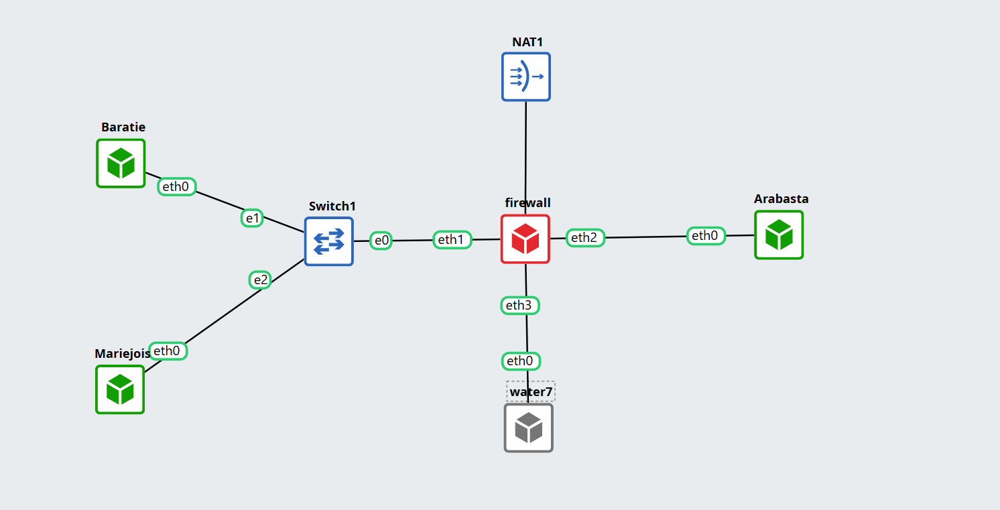

# Implementasi Firewall

Pada bagian ini, praktikan menerapkan firewall secara langsung menggunakan GNS3. Seluruh konsep pada [materi Firewall](../Firewall/README.md) dicoba pada sebuah router Linux, dari rule paling sederhana sampai rule yang memakai waktu, NAT, dan status koneksi.

Implementasi menggunakan:

- `debinet` untuk `Firewall` (router) dan `Water7` (server), karena keduanya membutuhkan `iptables` dan `apt`
- `alpinet` untuk `Baratie`, `Mariejois`, dan `Arabasta` (PC)
- `iptables` sebagai firewall
- `nc` (netcat) sebagai alat uji koneksi TCP

Implementasi ini menggantikan latihan berbasis Cisco Packet Tracer pada modul sebelumnya. Empat kebutuhan pada latihan lama dijalankan satu per satu sebagai skenario:

| Skenario | Kebutuhan | Teknik yang dipakai |
|---|---|---|
| 1 | PC Baratie tidak diizinkan mengakses server Water7 | `FORWARD` pada router |
| 2 | PC Arabasta tidak dapat diakses pada pukul 07.00 sampai 17.00 | `FORWARD` dengan match `time` |
| 3 | Server Water7 tidak diperbolehkan menerima koneksi HTTP | `INPUT` pada Water7, `DROP` dan `REJECT` |
| 4 | Semua paket yang menuju PC Baratie diarahkan ke PC Mariejois | DNAT pada `PREROUTING` |

Setelah keempatnya, bagian 10 membahas *default deny* dengan rule stateful, dan bagian 11 membahas cara menyimpan rule supaya tidak hilang saat node di-restart.

> **Catatan:** IP address pada contoh implementasi menggunakan `10.50.1.0/24`, `10.50.2.0/24`, dan `10.50.3.0/24` agar langkah lebih mudah diikuti. Jika kelompok kalian memiliki prefix sendiri, ganti seluruh alamat secara konsisten, termasuk pada rule iptables.

---

## Daftar Isi

- [1. Persiapan GNS3](#1-persiapan-gns3)
- [2. Konfigurasi Router Firewall](#2-konfigurasi-router-firewall)
- [3. Konfigurasi Host](#3-konfigurasi-host)
- [4. Pengujian Awal](#4-pengujian-awal)
- [5. Memahami INPUT, FORWARD, dan OUTPUT](#5-memahami-input-forward-dan-output)
- [6. Skenario 1: Memblokir Baratie ke Water7](#6-skenario-1-memblokir-baratie-ke-water7)
- [7. Skenario 2: Memblokir Arabasta pada Jam Tertentu](#7-skenario-2-memblokir-arabasta-pada-jam-tertentu)
- [8. Skenario 3: Water7 Menolak HTTP](#8-skenario-3-water7-menolak-http)
- [9. Skenario 4: Mengalihkan Baratie ke Mariejois dengan DNAT](#9-skenario-4-mengalihkan-baratie-ke-mariejois-dengan-dnat)
- [10. Default Deny dan Stateful Filtering](#10-default-deny-dan-stateful-filtering)
- [11. Persistensi](#11-persistensi)
- [12. Troubleshooting](#12-troubleshooting)
- [13. Final Verification dan Reset](#13-final-verification-dan-reset)

---

# 1. Persiapan GNS3

## 1.1 Topologi

Buat topologi berikut pada GNS3.

<!-- SS-01: Screenshot topologi lengkap di GNS3: NAT1, Firewall, Switch1, Baratie, Mariejois, Arabasta, Water7. Label interface pada setiap kabel (eth0 sampai eth3) harus terlihat. -->


Gambaran logisnya:

```text
                               [NAT1]
                                  |
                                eth0
                          +--------------+
 [Baratie]                |              |
  10.50.1.2 ---+          |              |--eth2--- [Arabasta]
               |          |   Firewall   |          10.50.2.2
          [Switch1]--eth1-|              |
               |          |              |--eth3--- [Water7]
  10.50.1.3 ---+          |              |          10.50.3.2
 [Mariejois]              +--------------+

 Firewall:  eth1 = 10.50.1.1/24   eth2 = 10.50.2.1/24   eth3 = 10.50.3.1/24
```

Topologi terdiri dari:

| Node | Fungsi | Image |
|---|---|---|
| `NAT1` | Akses internet untuk instalasi package dan uji NAT | NAT GNS3 |
| `Firewall` | Router sekaligus firewall | `debinet` (4 network adapter) |
| `Switch1` | Menghubungkan dua PC pada LAN 1 | Ethernet switch |
| `Baratie` | PC pada LAN 1 | `alpinet` |
| `Mariejois` | PC pada LAN 1, tujuan DNAT pada skenario 4 | `alpinet` |
| `Arabasta` | PC pada LAN 2 | `alpinet` |
| `Water7` | Server pada LAN 3 | `debinet` |

`Switch1` dibutuhkan karena LAN 1 berisi dua host. LAN 2 dan LAN 3 masing-masing hanya berisi satu host, sehingga dihubungkan langsung ke router.

Node `Firewall` membutuhkan **4 network adapter** (`eth0` sampai `eth3`). Jika template `debinet` hanya memiliki satu adapter, hentikan node, klik kanan, pilih **Configure**, lalu atur jumlah adapter pada bagian jaringan sebelum node dihubungkan.

<!-- UJI: pastikan menu pengaturan jumlah adapter pada node docker memang ada di Configure > Network (General settings) pada versi GNS3 yang dipakai; sesuaikan kalimat di atas. -->
<!-- SS-02: Screenshot pengaturan jumlah network adapter pada node Firewall (Configure). -->


## 1.2 Pembagian Jaringan

| Jaringan | Network | Gateway | Isi |
|---|---|---|---|
| LAN 1 | `10.50.1.0/24` | `10.50.1.1` | Baratie, Mariejois |
| LAN 2 | `10.50.2.0/24` | `10.50.2.1` | Arabasta |
| LAN 3 | `10.50.3.0/24` | `10.50.3.1` | Water7 |

Alamat setiap node:

| Node | Interface | Mode | IP Address | Gateway |
|---|---|---|---|---|
| `Firewall` | `eth0` | DHCP | otomatis dari NAT | otomatis |
| | `eth1` | Static | `10.50.1.1/24` | - |
| | `eth2` | Static | `10.50.2.1/24` | - |
| | `eth3` | Static | `10.50.3.1/24` | - |
| `Baratie` | `eth0` | Static | `10.50.1.2/24` | `10.50.1.1` |
| `Mariejois` | `eth0` | Static | `10.50.1.3/24` | `10.50.1.1` |
| `Arabasta` | `eth0` | Static | `10.50.2.2/24` | `10.50.2.1` |
| `Water7` | `eth0` | Static | `10.50.3.2/24` | `10.50.3.1` |

## 1.3 Hubungan Interface

| Node | Interface | Terhubung ke |
|---|---|---|
| `Firewall` | `eth0` | `NAT1` |
| `Firewall` | `eth1` | `Switch1` |
| `Firewall` | `eth2` | `Arabasta` `eth0` |
| `Firewall` | `eth3` | `Water7` `eth0` |
| `Baratie` | `eth0` | `Switch1` |
| `Mariejois` | `eth0` | `Switch1` |

Pastikan interface pada GNS3 sesuai dengan hasil `ip -br a` pada masing-masing node. Rule iptables pada modul ini menyebut nama interface (`eth1`, `eth3`, dan seterusnya), sehingga kabel yang tertukar akan membuat rule menyasar jaringan yang salah.

---

# 2. Konfigurasi Router Firewall

`Firewall` menghubungkan tiga LAN dan juga menjadi pintu keluar ke internet melalui `NAT1`.

## 2.1 Periksa Interface

Nyalakan node `Firewall`, buka console, lalu jalankan:

```bash
ip -br a
```

Pastikan terdapat `eth0`, `eth1`, `eth2`, dan `eth3`. Pada tahap ini `eth0` seharusnya sudah mendapat IP dari NAT, sedangkan `eth1` sampai `eth3` belum memiliki alamat.

## 2.2 Konfigurasi Interface

Tulis konfigurasi interface:

```bash
cat > /etc/network/interfaces <<'EOF'
auto lo
iface lo inet loopback

auto eth0
iface eth0 inet dhcp

auto eth1
iface eth1 inet static
    address 10.50.1.1
    netmask 255.255.255.0

auto eth2
iface eth2 inet static
    address 10.50.2.1
    netmask 255.255.255.0

auto eth3
iface eth3 inet static
    address 10.50.3.1
    netmask 255.255.255.0
EOF
```

Terapkan:

```bash
for i in 0 1 2 3; do ifdown eth$i 2>/dev/null; ifup eth$i; done
```

<!-- UJI: pastikan ifdown/ifup tersedia dan berjalan di image debinet. Jika tidak, ganti dengan ip addr add (lihat bagian 12). -->

Verifikasi:

```bash
ip -br a
ip route
```

Hasil yang diharapkan: `eth1`, `eth2`, dan `eth3` berstatus `UP` dengan alamat `10.50.1.1/24`, `10.50.2.1/24`, dan `10.50.3.1/24`. Pada `ip route` terdapat satu route default (lewat `eth0`) dan tiga route jaringan lokal.

<!-- SS-03: Screenshot hasil ip -br a dan ip route pada Firewall setelah konfigurasi. -->


## 2.3 Aktifkan IP Forwarding

Supaya paket dapat diteruskan antar-subnet, aktifkan forwarding:

```bash
sysctl -w net.ipv4.ip_forward=1
```

Periksa:

```bash
sysctl net.ipv4.ip_forward
```

Hasil yang diharapkan:

```text
net.ipv4.ip_forward = 1
```

## 2.4 Akses Internet dan NAT

Pasang DNS resolver, lalu uji koneksi router ke internet:

```bash
echo "nameserver 8.8.8.8" > /etc/resolv.conf
ping -c 3 8.8.8.8
```

Instal package yang dibutuhkan:

```bash
apt update && apt install -y iptables conntrack
```

Periksa versi iptables:

```bash
iptables --version
```

Keluarannya berakhiran `(nf_tables)` atau `(legacy)`. Keduanya dapat dipakai pada modul ini.

<!-- SS-04: Screenshot iptables --version dan ping 8.8.8.8 berhasil pada Firewall. -->


Aktifkan NAT agar host di belakang router dapat keluar ke internet:

```bash
iptables -t nat -A POSTROUTING -o eth0 -j MASQUERADE
```

Rule ini sama dengan yang dipakai pada Modul 1: alamat sumber paket yang keluar lewat `eth0` diganti dengan IP milik `eth0`, karena IP privat `10.50.x.x` tidak dikenal oleh jaringan di luar.

---

# 3. Konfigurasi Host

## 3.1 Baratie

Masuk ke console `Baratie`:

```bash
cat > /etc/network/interfaces <<'EOF'
auto lo
iface lo inet loopback

auto eth0
iface eth0 inet static
    address 10.50.1.2
    netmask 255.255.255.0
    gateway 10.50.1.1
EOF
ifdown eth0 2>/dev/null; ifup eth0
ip -br a
ip route
```

Hasil yang diharapkan: `eth0` memiliki alamat `10.50.1.2/24`, dan route default mengarah ke `10.50.1.1`.

<!-- SS-05: Screenshot ip -br a dan ip route pada Baratie (cukup satu PC sebagai contoh). -->


## 3.2 Mariejois

Masuk ke console `Mariejois`:

```bash
cat > /etc/network/interfaces <<'EOF'
auto lo
iface lo inet loopback

auto eth0
iface eth0 inet static
    address 10.50.1.3
    netmask 255.255.255.0
    gateway 10.50.1.1
EOF
ifdown eth0 2>/dev/null; ifup eth0
ip -br a
ip route
```

## 3.3 Arabasta

Masuk ke console `Arabasta`:

```bash
cat > /etc/network/interfaces <<'EOF'
auto lo
iface lo inet loopback

auto eth0
iface eth0 inet static
    address 10.50.2.2
    netmask 255.255.255.0
    gateway 10.50.2.1
EOF
ifdown eth0 2>/dev/null; ifup eth0
ip -br a
ip route
```

## 3.4 Water7

`Water7` adalah server yang memakai `debinet`, dan perlu memasang `iptables` serta `netcat`.

```bash
cat > /etc/network/interfaces <<'EOF'
auto lo
iface lo inet loopback

auto eth0
iface eth0 inet static
    address 10.50.3.2
    netmask 255.255.255.0
    gateway 10.50.3.1
EOF
ifdown eth0 2>/dev/null; ifup eth0
echo "nameserver 8.8.8.8" > /etc/resolv.conf
ip -br a
ip route
ping -c 3 8.8.8.8
```

Jika `ping 8.8.8.8` berhasil, NAT pada `Firewall` berjalan. Lanjutkan dengan instalasi package:

```bash
apt update && apt install -y iptables netcat-traditional
```

Varian `netcat-traditional` dipilih agar penulisan perintah `nc` seragam dengan yang dipakai pada materi (`nc -l -p [PORT]`). Pastikan varian tersebut aktif:

```bash
nc -h 2>&1 | head -n 1
```

<!-- UJI: pastikan keluaran nc -h menunjukkan versi traditional (misal [v1.10-xx]). Jika yang aktif varian lain, jalankan: update-alternatives --set nc /bin/nc.traditional -->

<!-- SS-06: Screenshot instalasi iptables dan netcat-traditional berhasil pada Water7, beserta keluaran nc -h. -->


> **Penting:** selesaikan instalasi package pada `Water7` **sebelum** mengerjakan bagian 10. Pada bagian itu `Water7` tidak lagi diizinkan keluar ke internet, sehingga `apt` tidak akan berfungsi.

---

# 4. Pengujian Awal

Sebelum firewall dipasang, pastikan seluruh jaringan berfungsi. Pengujian ini juga menjadi pembanding untuk hasil pada skenario berikutnya.

Dari `Baratie`:

```bash
ping -c 2 -W 2 10.50.1.1
ping -c 2 -W 2 10.50.1.3
ping -c 2 -W 2 10.50.2.2
ping -c 2 -W 2 10.50.3.2
ping -c 2 -W 2 8.8.8.8
```

Hasil yang diharapkan: seluruhnya berhasil. Hal yang sama berlaku untuk `Mariejois`, `Arabasta`, dan `Water7`.

Ringkasan hasil yang diharapkan:

| Dari | Ke | Hasil |
|---|---|---|
| `Baratie` | `Water7` (`10.50.3.2`) | Berhasil |
| `Mariejois` | `Arabasta` (`10.50.2.2`) | Berhasil |
| `Arabasta` | `Water7` (`10.50.3.2`) | Berhasil |
| `Water7` | `Baratie` (`10.50.1.2`) | Berhasil |
| `Baratie`, `Water7` | `8.8.8.8` | Berhasil (lewat NAT) |

<!-- SS-07: Screenshot ping dari Baratie ke Water7, Arabasta, dan 8.8.8.8 yang seluruhnya berhasil. -->


Periksa kondisi iptables pada `Firewall`:

```bash
iptables -S
iptables -t nat -S
```

Hasil yang diharapkan:

```text
-P INPUT ACCEPT
-P FORWARD ACCEPT
-P OUTPUT ACCEPT
```

dan pada table `nat` hanya terdapat satu rule `MASQUERADE` pada `POSTROUTING`. Artinya, pada kondisi ini `Firewall` hanya meneruskan paket dan belum menyaring apa pun, sesuai penjelasan pada bagian 6.2 materi.

<!-- SS-08: Screenshot iptables -S dan iptables -t nat -S pada Firewall (kondisi awal, policy ACCEPT, hanya MASQUERADE). -->


---

# 5. Memahami INPUT, FORWARD, dan OUTPUT

Sebelum masuk ke skenario, bagian ini membuktikan satu hal yang sering membingungkan: **rule yang sama bisa berpengaruh atau tidak, bergantung pada chain tempat rule itu dipasang**. Seluruh rule pada bagian ini dipasang di `Firewall`, dan semuanya dihapus lagi di akhir.

## 5.1 Rule pada FORWARD

Pasang rule yang membuang ping (`echo-request`) pada chain `FORWARD`:

```bash
iptables -A FORWARD -p icmp --icmp-type echo-request -j DROP
```

Dari `Baratie`, uji dua tujuan:

```bash
ping -c 2 -W 2 10.50.1.1
ping -c 2 -W 2 10.50.3.2
```

Hasil yang diharapkan:

| Tujuan | Hasil | Alasan |
|---|---|---|
| `10.50.1.1` (router itu sendiri) | Berhasil | Paket ditujukan ke router, jalurnya `PREROUTING` -> `INPUT`. `FORWARD` tidak dilewati. |
| `10.50.3.2` (Water7) | Gagal | Paket hanya melewati router, jalurnya `PREROUTING` -> `FORWARD` -> `POSTROUTING`. |

Pada `Firewall`, lihat counter:

```bash
iptables -L FORWARD -n -v --line-numbers
```

Kolom `pkts` pada rule bernomor 1 bertambah sesuai jumlah ping yang dikirim. Hapus rule:

```bash
iptables -F FORWARD
```

<!-- SS-09: Screenshot dua ping dari Baratie (ke 10.50.1.1 berhasil, ke 10.50.3.2 gagal) dan iptables -L FORWARD -n -v dengan counter bertambah. -->


## 5.2 Rule pada INPUT

Pasang rule yang **sama** pada chain `INPUT`:

```bash
iptables -A INPUT -p icmp --icmp-type echo-request -j DROP
```

Ulangi dua ping dari `Baratie`:

```bash
ping -c 2 -W 2 10.50.1.1
ping -c 2 -W 2 10.50.3.2
```

Hasil yang diharapkan sekarang **terbalik**:

| Tujuan | Hasil | Alasan |
|---|---|---|
| `10.50.1.1` (router itu sendiri) | Gagal | Paket masuk ke chain `INPUT`. |
| `10.50.3.2` (Water7) | Berhasil | Paket hanya lewat, tidak pernah menyentuh `INPUT`. |

Hapus rule:

```bash
iptables -F INPUT
```

<!-- SS-10: Screenshot dua ping dari Baratie setelah rule dipasang di INPUT (ke router gagal, ke Water7 berhasil). -->


## 5.3 Rule pada OUTPUT

Chain `OUTPUT` hanya berlaku untuk paket yang **dibuat oleh router sendiri**. Pasang rule yang membuang semua paket dari router menuju `Water7`:

```bash
iptables -A OUTPUT -d 10.50.3.2 -j DROP
```

Uji pada `Firewall`:

```bash
ping -c 2 -W 2 10.50.3.2
```

Uji juga dari `Baratie`:

```bash
ping -c 2 -W 2 10.50.3.2
```

Hasil yang diharapkan:

| Dari | Ke | Hasil | Alasan |
|---|---|---|---|
| `Firewall` | `Water7` | Gagal | Paket dibuat oleh router, melewati `OUTPUT`. |
| `Baratie` | `Water7` | Berhasil | Paket milik Baratie hanya diteruskan router, `OUTPUT` tidak dilewati. |

Hapus rule:

```bash
iptables -F OUTPUT
```

<!-- SS-11: Screenshot ping dari Firewall ke Water7 (gagal) dan dari Baratie ke Water7 (berhasil) saat rule OUTPUT aktif. -->


## 5.4 Kesimpulan

| Chain | Berlaku untuk | Dipakai pada modul ini untuk |
|---|---|---|
| `INPUT` | Paket yang ditujukan ke mesin itu sendiri | Melindungi `Water7` (skenario 3) |
| `FORWARD` | Paket yang hanya melewati mesin | Mengatur lalu lintas antar-LAN di `Firewall` (skenario 1 dan 2) |
| `OUTPUT` | Paket yang dibuat oleh mesin itu sendiri | Tidak dipakai pada skenario, hanya demo |

Pastikan seluruh rule sudah bersih sebelum lanjut:

```bash
iptables -F
iptables -S
```

Hasil yang diharapkan: hanya tiga baris `-P ... ACCEPT`.

---

# 6. Skenario 1: Memblokir Baratie ke Water7

**Kebutuhan:** PC `Baratie` tidak diizinkan mengakses server `Water7`.

`Baratie` berada di LAN 1 dan `Water7` di LAN 3, sehingga lalu lintas di antara keduanya selalu melewati `Firewall`. Rule dipasang pada chain `FORWARD`.

## 6.1 Pasang Rule

Pada `Firewall`:

```bash
iptables -A FORWARD -s 10.50.1.2 -d 10.50.3.2 -j DROP
```

Arti rule: paket yang melewati router, berasal dari `10.50.1.2` (Baratie) dan menuju `10.50.3.2` (Water7), dibuang.

Periksa:

```bash
iptables -L FORWARD -n -v --line-numbers
```

<!-- SS-12: Screenshot iptables -L FORWARD -n -v --line-numbers pada Firewall setelah rule skenario 1 dipasang (counter masih 0). -->


## 6.2 Uji

Dari `Baratie`:

```bash
ping -c 2 -W 2 10.50.3.2
```

Dari `Mariejois` dan `Arabasta`:

```bash
ping -c 2 -W 2 10.50.3.2
```

Hasil yang diharapkan:

| Dari | Ke | Hasil |
|---|---|---|
| `Baratie` | `Water7` | **Gagal** |
| `Mariejois` | `Water7` | Berhasil |
| `Arabasta` | `Water7` | Berhasil |
| `Baratie` | `Arabasta` | Berhasil |
| `Baratie` | `8.8.8.8` | Berhasil |

Hanya pasangan `Baratie` dan `Water7` yang terputus. Host lain tidak terpengaruh, begitu pula tujuan lain milik `Baratie`.

<!-- SS-13: Screenshot ping dari Baratie ke Water7 (gagal) dan dari Mariejois ke Water7 (berhasil). -->


## 6.3 Perhatikan Counter

Pada `Firewall`:

```bash
iptables -L FORWARD -n -v --line-numbers
```

Kolom `pkts` pada rule bernomor 1 sekarang tidak nol. Itu bukti bahwa rule ini yang menangani paket tadi.

## 6.4 Arah Sebaliknya

Dari `Water7`, uji ping ke `Baratie`:

```bash
ping -c 2 -W 2 10.50.1.2
```

Hasil yang diharapkan: **gagal juga**, meskipun rule hanya menyebut Baratie sebagai sumber. Permintaan dari `Water7` memang lolos, tetapi **balasan** dari `Baratie` ke `Water7` memiliki sumber `10.50.1.2` dan tujuan `10.50.3.2`, persis seperti yang dibuang rule tadi. Rule ini stateless, sehingga ia tidak membedakan permintaan dari balasan. Konsep ini dibahas pada bagian 10 materi.

## 6.5 Bersihkan Rule

```bash
iptables -D FORWARD -s 10.50.1.2 -d 10.50.3.2 -j DROP
```

---

# 7. Skenario 2: Memblokir Arabasta pada Jam Tertentu

**Kebutuhan:** PC `Arabasta` tidak dapat diakses pada pukul 07.00 sampai 17.00.

Rule ini memakai match `time`. Match tersebut membaca jam dalam **UTC**, sehingga jam WIB harus dikonversi (WIB = UTC + 7):

| Waktu (WIB) | Waktu (UTC) |
|---|---|
| 07.00 | 00:00 |
| 17.00 | 10:00 |

Jadi rentang yang dimaksud ditulis `--timestart 00:00 --timestop 10:00`.

## 7.1 Cek Jam pada Router

Pada `Firewall`:

```bash
date -u
```

Catat jam UTC yang tampil. Pada contoh di bawah, jam UTC saat ini diandaikan **06:56**. Sesuaikan dengan jam pada node kalian.

<!-- SS-14: Screenshot keluaran date -u pada Firewall. -->


## 7.2 Bukti: Rentang yang Mencakup Jam Sekarang

Agar efek rule langsung terlihat, pakai rentang yang **mencakup** jam sekarang. Jika jam UTC saat ini 06:56, rentang `06:00` sampai `08:00` sudah cukup:

```bash
iptables -A FORWARD -d 10.50.2.2 -m time --timestart 06:00 --timestop 08:00 -j DROP
```

Sesuaikan `--timestart` dan `--timestop` dengan hasil `date -u` kalian.

Dari `Mariejois`:

```bash
ping -c 2 -W 2 10.50.2.2
```

Hasil yang diharapkan: **gagal**. Pada `Firewall`, `iptables -L FORWARD -n -v` menunjukkan counter rule bertambah, dan kolom keterangan menampilkan rentang waktu dengan akhiran `UTC`.

<!-- SS-15: Screenshot rule time pada iptables -L FORWARD -n -v (ada tulisan TIME from ... to ... UTC) dan ping dari Mariejois ke Arabasta yang gagal. -->


## 7.3 Bukti: Rentang yang Tidak Mencakup Jam Sekarang

Hapus rule tadi, lalu pasang rule dengan rentang yang **tidak** mencakup jam sekarang. Dengan jam UTC 06:56, rentang `12:00` sampai `13:00` aman dipakai:

```bash
iptables -D FORWARD -d 10.50.2.2 -m time --timestart 06:00 --timestop 08:00 -j DROP
iptables -A FORWARD -d 10.50.2.2 -m time --timestart 12:00 --timestop 13:00 -j DROP
```

Ulangi ping dari `Mariejois`:

```bash
ping -c 2 -W 2 10.50.2.2
```

Hasil yang diharapkan: **berhasil**, karena jam sekarang berada di luar rentang.

<!-- SS-16: Screenshot ping dari Mariejois ke Arabasta berhasil saat rentang waktu tidak mencakup jam sekarang. -->


## 7.4 Rule Sesuai Kebutuhan

Setelah perilakunya terbukti, ganti dengan rule yang sesuai kebutuhan, yaitu 07.00 sampai 17.00 WIB:

```bash
iptables -D FORWARD -d 10.50.2.2 -m time --timestart 12:00 --timestop 13:00 -j DROP
iptables -A FORWARD -d 10.50.2.2 -m time --timestart 00:00 --timestop 10:00 -j DROP
```

Hasilnya bergantung pada kapan pengujian dilakukan:

| Waktu pengujian | Ping ke `Arabasta` |
|---|---|
| 07.00 sampai 17.00 WIB (00:00 sampai 10:00 UTC) | Gagal |
| Di luar rentang tersebut | Berhasil |

Periksa bentuk rule yang tersimpan:

```bash
iptables -S FORWARD
```

Pada sebagian versi iptables, baris rule ini ikut menampilkan `--datestop 2038-01-19T03:14:07`. Itu tampilan bawaan dan tidak perlu diubah.

## 7.5 Catatan

- Rule memakai `-d` (tujuan), sehingga yang tertutup adalah **akses menuju** `Arabasta`. Karena rule ini stateless, balasan untuk koneksi yang dimulai `Arabasta` sendiri (misalnya `Arabasta` ping `Water7`) juga bertujuan ke `Arabasta` dan ikut terbuang pada rentang tersebut. Silakan buktikan sendiri pada rentang yang mencakup jam sekarang.
- Rule `FORWARD` hanya mengatur paket yang **melewati** router. Akses dari `Firewall` itu sendiri ke `Arabasta` melewati chain `OUTPUT`, sehingga bila ingin ikut ditutup, diperlukan rule serupa pada `OUTPUT`.

## 7.6 Bersihkan Rule

```bash
iptables -F FORWARD
```

---

# 8. Skenario 3: Water7 Menolak HTTP

**Kebutuhan:** server `Water7` tidak diperbolehkan menerima koneksi HTTP.

HTTP memakai TCP port 80. Berbeda dengan dua skenario sebelumnya, rule ini dipasang **pada `Water7` sendiri**, di chain `INPUT`, karena yang ingin dibatasi adalah apa yang diterima server itu. Cara ini disebut *host-based firewall* dan melindungi `Water7` dari **semua** sumber, termasuk host yang berada di LAN yang sama dengannya.

> Rule yang setara bisa juga dipasang di `Firewall` dengan `iptables -A FORWARD -d 10.50.3.2 -p tcp --dport 80 -j DROP`. Bedanya, rule itu hanya melindungi dari lalu lintas yang melewati router.

Pengujian memakai `nc`, dengan port 80 sebagai port yang ditutup dan port 8080 sebagai pembanding yang tetap terbuka.

## 8.1 Siapkan Listener dan Uji Sebelum Rule

Pada `Water7`, buka dua listener di latar belakang. Keluaran masing-masing ditulis ke file:

```bash
nc -l -p 80 > /tmp/p80.txt &
nc -l -p 8080 > /tmp/p8080.txt &
```

Dari `Mariejois`, kirim satu pesan ke setiap port:

```bash
echo "halo-80" | nc -w 3 10.50.3.2 80; echo "exit=$?"
echo "halo-8080" | nc -w 3 10.50.3.2 8080; echo "exit=$?"
```

Pada `Water7`, periksa isi file:

```bash
cat /tmp/p80.txt
cat /tmp/p8080.txt
```

Hasil yang diharapkan: `p80.txt` berisi `halo-80` dan `p8080.txt` berisi `halo-8080`. Kedua port masih terbuka. Listener berhenti sendiri setelah satu koneksi selesai.

<!-- UJI: sintaks nc -l -p dengan netcat-traditional di Water7 dan nc client busybox di Mariejois; cek apakah exit status 0 saat berhasil. Jika busybox nc tidak keluar sendiri setelah EOF, tambahkan -w 1. -->

<!-- SS-17: Screenshot pengujian sebelum rule: isi p80.txt dan p8080.txt pada Water7 (keduanya berisi pesan). -->


## 8.2 Pasang Rule DROP

Pada `Water7`:

```bash
iptables -A INPUT -p tcp --dport 80 -j DROP
```

Nyalakan ulang listener (listener lama sudah berhenti), dan kosongkan file:

```bash
pkill nc
nc -l -p 80 > /tmp/p80.txt &
nc -l -p 8080 > /tmp/p8080.txt &
```

Dari `Mariejois`:

```bash
echo "halo-80" | nc -w 3 10.50.3.2 80; echo "exit=$?"
echo "halo-8080" | nc -w 3 10.50.3.2 8080; echo "exit=$?"
```

Hasil yang diharapkan:

| Port | Perilaku | Isi file pada Water7 |
|---|---|---|
| 80 | Perintah **menggantung sekitar 3 detik** (sesuai `-w 3`), lalu selesai dengan `exit` bukan 0 | Kosong |
| 8080 | Berhasil, `exit=0` | Berisi `halo-8080` |

Port 80 tidak pernah menjawab, dan pengirim menunggu sampai timeout. Itulah ciri khas `DROP`.

<!-- SS-18: Screenshot dari Mariejois: nc ke port 80 menggantung lalu gagal, nc ke port 8080 berhasil; serta cat /tmp/p80.txt (kosong) dan /tmp/p8080.txt (berisi) pada Water7. -->


Lihat counter pada `Water7`:

```bash
iptables -L INPUT -n -v --line-numbers
```

Kolom `pkts` pada rule `DROP` bertambah. Jumlahnya bisa lebih dari satu karena klien mengirim ulang paket `SYN` selama menunggu jawaban.

## 8.3 Ganti dengan REJECT

Ganti `DROP` dengan `REJECT` untuk membandingkannya:

```bash
iptables -D INPUT -p tcp --dport 80 -j DROP
iptables -A INPUT -p tcp --dport 80 -j REJECT --reject-with tcp-reset
```

Nyalakan ulang listener port 80:

```bash
pkill nc
nc -l -p 80 > /tmp/p80.txt &
```

Uji lagi dari `Mariejois`:

```bash
echo "halo-80" | nc -w 3 10.50.3.2 80; echo "exit=$?"
```

Hasil yang diharapkan: perintah **langsung selesai** dengan pesan penolakan (`Connection refused` atau sejenisnya) dan `exit` bukan 0, tanpa menunggu 3 detik.

<!-- SS-19: Screenshot nc ke port 80 saat rule REJECT: langsung gagal tanpa menggantung. -->


| | `DROP` | `REJECT` |
|---|---|---|
| Waktu sampai gagal | Sekitar 3 detik (timeout) | Hampir seketika |
| Yang dikirim server | Tidak ada | Paket `RST` |

## 8.4 Mengamati dengan tcpdump (Opsional)

Untuk melihat perbedaannya pada level paket, pasang `tcpdump` di `Water7`:

```bash
apt install -y tcpdump
```

Jalankan di latar belakang, lalu uji dari `Mariejois`:

```bash
tcpdump -i eth0 -n -l tcp port 80 > /tmp/dump80.txt 2>&1 &
```

Setelah pengujian selesai:

```bash
pkill tcpdump
cat /tmp/dump80.txt
```

Hasil yang diharapkan: pada kondisi `DROP`, hanya terlihat paket `SYN` yang datang (beberapa kali, karena dikirim ulang) tanpa jawaban. Pada kondisi `REJECT`, terlihat `SYN` yang segera dijawab paket `RST`. `tcpdump` menangkap paket sebelum diproses firewall, sehingga paket yang akhirnya dibuang pun tetap terlihat masuk.

<!-- SS-20: (opsional) Screenshot isi dump80.txt pada kondisi DROP (SYN berulang tanpa balasan) dan kondisi REJECT (SYN lalu RST). -->


## 8.5 Bersihkan

```bash
iptables -F INPUT
pkill nc
```

---

# 9. Skenario 4: Mengalihkan Baratie ke Mariejois dengan DNAT

**Kebutuhan:** semua paket yang menuju PC `Baratie` diarahkan ke PC `Mariejois`.

Pengalihan alamat tujuan dilakukan dengan **DNAT** pada chain `PREROUTING` di `Firewall`. Penguji berada di `Water7` (LAN 3), sehingga paketnya pasti melewati router. `Baratie` dan `Mariejois` berada pada LAN yang sama, tetapi itu tidak mengganggu karena penguji berada di luar LAN tersebut.

## 9.1 Siapkan Listener dan Uji Sebelum DNAT

Pada `Baratie`:

```bash
nc -l -p 9000 > /tmp/baratie.txt &
```

Pada `Mariejois`:

```bash
nc -l -p 9000 > /tmp/mariejois.txt &
```

Dari `Water7`, kirim pesan ke alamat `Baratie`:

```bash
echo "sebelum-dnat" | nc -w 3 10.50.1.2 9000; echo "exit=$?"
```

Periksa pada `Baratie` dan `Mariejois`:

```bash
cat /tmp/baratie.txt
cat /tmp/mariejois.txt
```

Hasil yang diharapkan: `baratie.txt` berisi `sebelum-dnat`, sedangkan `mariejois.txt` kosong. Pesan sampai ke tujuan yang benar.

<!-- SS-21: Screenshot sebelum DNAT: pesan dikirim dari Water7, isi baratie.txt terisi dan mariejois.txt kosong. -->


## 9.2 Pasang Rule DNAT

Nyalakan ulang listener pada `Baratie` dan `Mariejois` (listener lama sudah berhenti):

```bash
pkill nc
nc -l -p 9000 > /tmp/baratie.txt &
```

```bash
pkill nc
nc -l -p 9000 > /tmp/mariejois.txt &
```

Pada `Firewall`, pasang rule:

```bash
iptables -t nat -A PREROUTING -d 10.50.1.2 -j DNAT --to-destination 10.50.1.3
```

Arti rule: paket yang masuk ke router dengan tujuan `10.50.1.2` (Baratie) diubah tujuannya menjadi `10.50.1.3` (Mariejois) sebelum keputusan routing.

Periksa table `nat`:

```bash
iptables -t nat -L PREROUTING -n -v --line-numbers
```

<!-- SS-22: Screenshot iptables -t nat -L PREROUTING -n -v --line-numbers setelah rule DNAT dipasang. -->


## 9.3 Uji Setelah DNAT

Dari `Water7`, kirim pesan ke **alamat yang sama** seperti tadi, yaitu alamat `Baratie`:

```bash
echo "sesudah-dnat" | nc -w 3 10.50.1.2 9000; echo "exit=$?"
```

Periksa pada `Baratie` dan `Mariejois`:

```bash
cat /tmp/baratie.txt
cat /tmp/mariejois.txt
```

Hasil yang diharapkan: kali ini `mariejois.txt` berisi `sesudah-dnat`, sedangkan `baratie.txt` **kosong**. Pengirim tetap mengetik alamat `Baratie`, tetapi paketnya tiba di `Mariejois`.

<!-- SS-23: Screenshot sesudah DNAT: baratie.txt kosong dan mariejois.txt berisi pesan. -->


## 9.4 Buktikan dengan tcpdump dan conntrack

Pada `Mariejois`, tangkap ICMP di latar belakang:

```bash
tcpdump -i eth0 -n -l icmp > /tmp/icmp.txt 2>&1 &
```

Dari `Water7`, ping alamat `Baratie`:

```bash
ping -c 2 -W 2 10.50.1.2
```

Perhatikan bahwa balasannya **tetap tampak datang dari `10.50.1.2`**, sehingga penguji tidak bisa membedakan dari ping saja. Firewall menerjemahkan alamat sumber balasan kembali ke alamat yang diharapkan pengirim.

Pada `Mariejois`:

```bash
pkill tcpdump
cat /tmp/icmp.txt
```

Hasil yang diharapkan: terlihat paket `echo request` dari `10.50.3.2` menuju `10.50.1.3` (alamat Mariejois, bukan Baratie), dan `echo reply` kembali dari `10.50.1.3`. Berarti paket benar-benar sampai ke `Mariejois`.

Pada `Firewall`, lihat catatan terjemahan alamat:

```bash
conntrack -L 2>/dev/null | grep 9000
```

Hasilnya berupa satu baris dengan dua kelompok alamat. Contoh bentuknya:

```text
tcp  6 117 TIME_WAIT src=10.50.3.2 dst=10.50.1.2 sport=52922 dport=9000 src=10.50.1.3 dst=10.50.3.2 sport=9000 dport=52922 [ASSURED]
```

Kelompok pertama adalah arah permintaan (`dst=10.50.1.2`, alamat Baratie yang diketik penguji). Kelompok kedua adalah arah balasan (`src=10.50.1.3`, alamat Mariejois yang sebenarnya membalas). Selisih antara kedua kelompok itulah hasil DNAT.

<!-- UJI: jika conntrack -L tidak menampilkan apa-apa atau tidak tersedia, gunakan: cat /proc/net/nf_conntrack | grep 9000 -->
<!-- SS-24: Screenshot isi icmp.txt pada Mariejois (tujuan 10.50.1.3) dan keluaran conntrack -L | grep 9000 pada Firewall. -->


## 9.5 Catatan

- IP forwarding harus aktif. Tanpanya paket yang sudah dialihkan tidak akan diteruskan oleh router.
- Rule DNAT hanya menyentuh paket pertama dari setiap koneksi. Paket-paket berikutnya dan balasannya diterjemahkan otomatis oleh connection tracking.
- Jika `FORWARD` berpolicy `DROP`, rule yang mengizinkan harus menyebut tujuan **setelah** DNAT, yaitu `10.50.1.3`, bukan `10.50.1.2`.

## 9.6 Bersihkan

Pada `Firewall`:

```bash
iptables -t nat -D PREROUTING -d 10.50.1.2 -j DNAT --to-destination 10.50.1.3
```

Pada `Baratie` dan `Mariejois`:

```bash
pkill nc
```

---

# 10. Default Deny dan Stateful Filtering

Pada skenario sebelumnya, semua chain memakai policy `ACCEPT` dan rule hanya menyebutkan apa yang **dilarang**. Bagian ini membalik arahnya: semua lalu lintas antar-LAN dilarang, dan hanya yang disebut yang diizinkan. Konsepnya ada pada bagian 4.4 dan 10 materi.

> **Peringatan:** setelah bagian ini, `Water7` tidak lagi diizinkan keluar ke internet. Pastikan semua `apt install` pada `Water7` sudah selesai (bagian 3.4 dan 8.4).

Pada `Firewall`, bersihkan rule sebelumnya tanpa menyentuh `MASQUERADE`:

```bash
iptables -F
iptables -t nat -F PREROUTING
iptables -S
```

## 10.1 Policy DROP Tanpa Rule Balasan

Ubah policy `FORWARD` menjadi `DROP`, lalu izinkan hanya paket dari LAN 1 (`eth1`) menuju internet (`eth0`):

```bash
iptables -P FORWARD DROP
iptables -A FORWARD -i eth1 -o eth0 -j ACCEPT
```

Dari `Baratie`:

```bash
ping -c 2 -W 2 8.8.8.8
```

Hasil yang diharapkan: **gagal**, padahal arah `eth1` ke `eth0` sudah diizinkan. Permintaan ping memang keluar, tetapi balasan dari internet masuk lewat `eth0` dan hendak keluar lewat `eth1`, arah yang tidak diizinkan oleh rule mana pun. Paket itu jatuh ke default policy dan dibuang.

Lihat counter:

```bash
iptables -L FORWARD -n -v --line-numbers
```

Baris pertama judul chain menampilkan `policy DROP` beserta jumlah paket yang dibuang karena tidak cocok dengan rule mana pun. Angka itu bertambah setiap ping.

<!-- SS-25: Screenshot ping dari Baratie ke 8.8.8.8 yang gagal, dan iptables -L FORWARD -n -v dengan policy DROP serta counter policy yang bertambah. -->


## 10.2 Tambahkan Rule Stateful

Sisipkan rule yang mengizinkan paket dari koneksi yang sudah ada **di posisi paling atas**:

```bash
iptables -I FORWARD 1 -m conntrack --ctstate ESTABLISHED,RELATED -j ACCEPT
```

Ulangi uji dari `Baratie`:

```bash
ping -c 2 -W 2 8.8.8.8
```

Hasil yang diharapkan: **berhasil**. Balasan sekarang dikenali sebagai bagian dari koneksi yang dimulai `Baratie`, sehingga lolos lewat rule baru.

Lanjutkan dengan pengujian dari host lain:

```bash
ping -c 2 -W 2 8.8.8.8
ping -c 2 -W 2 10.50.3.2
```

Jalankan kedua perintah itu dari `Mariejois`, lalu jalankan `ping -c 2 -W 2 8.8.8.8` dari `Water7`. Bandingkan dengan tabel:

| Dari | Ke | Hasil | Alasan |
|---|---|---|---|
| `Baratie` | `8.8.8.8` | Berhasil | LAN 1 ke internet diizinkan, balasannya `ESTABLISHED` |
| `Mariejois` | `8.8.8.8` | Berhasil | Sama seperti Baratie |
| `Water7` | `8.8.8.8` | Gagal | `eth3` ke `eth0` tidak diizinkan oleh rule mana pun |
| `Mariejois` | `Water7` | Gagal | LAN 1 ke LAN 3 belum diizinkan, jatuh ke policy `DROP` |

Hal yang berubah dari 10.1 hanya satu rule. Perhatikan bahwa koneksi yang dimulai dari internet menuju LAN tetap tertolak, karena paket pertamanya berstatus `NEW` dan tidak ada rule yang mengizinkannya.

<!-- SS-26: Screenshot ping dari Baratie ke 8.8.8.8 berhasil setelah rule ESTABLISHED,RELATED ditambahkan, dan ping Water7 ke 8.8.8.8 yang gagal. -->


## 10.3 Izinkan Satu Layanan Tertentu

Izinkan LAN 1 mengakses TCP port 8080 pada `Water7`, dan tidak yang lain:

```bash
iptables -A FORWARD -i eth1 -o eth3 -p tcp --dport 8080 -j ACCEPT
```

Pada `Water7`, buka listener:

```bash
nc -l -p 8080 > /tmp/p8080.txt &
```

Dari `Mariejois`:

```bash
echo "tes-8080" | nc -w 3 10.50.3.2 8080; echo "exit=$?"
ping -c 2 -W 2 10.50.3.2
```

Hasil yang diharapkan: pengiriman ke port 8080 **berhasil** (`p8080.txt` pada `Water7` berisi `tes-8080`), sedangkan `ping` ke `Water7` tetap **gagal**. Hanya TCP port 8080 dari LAN 1 yang diizinkan. Balasannya lolos karena rule `ESTABLISHED` di baris paling atas.

Tampilkan rule akhir:

```bash
iptables -L FORWARD -n -v --line-numbers
```

Susunan yang diharapkan:

```text
Chain FORWARD (policy DROP ...)
num   pkts bytes target     prot opt in     out     source       destination
1        .     . ACCEPT     0    --  *      *       0.0.0.0/0    0.0.0.0/0     ctstate RELATED,ESTABLISHED
2        .     . ACCEPT     0    --  eth1   eth0    0.0.0.0/0    0.0.0.0/0
3        .     . ACCEPT     6    --  eth1   eth3    0.0.0.0/0    0.0.0.0/0     tcp dpt:8080
```

<!-- SS-27: Screenshot iptables -L FORWARD -n -v --line-numbers berisi tiga rule beserta counter, serta nc ke port 8080 berhasil dan ping ke Water7 gagal. -->


## 10.4 Kembalikan ke Kondisi Awal

```bash
iptables -P FORWARD ACCEPT
iptables -F
pkill nc
```

Policy dikembalikan **sebelum** rule dihapus, agar tidak ada saat di mana semua lalu lintas terblokir.

---

# 11. Persistensi

Rule iptables hanya hidup di memori. Begitu node `Firewall` atau `Water7` di-stop lalu di-start, seluruh rule hilang dan jaringan kembali "terbuka". Konfigurasi dianggap selesai apabila rule tetap ada setelah node direstart.

Pada node GNS3, hanya `/etc/network/interfaces` dan folder `/root` yang bertahan setelah restart. Karena itu rule disimpan ke file di `/root`, lalu dimuat kembali lewat baris `up` pada `/etc/network/interfaces`.

## 11.1 Firewall

Susun rule akhir yang menggabungkan skenario 1, 2, dan 4 beserta NAT:

```bash
iptables -F
iptables -t nat -F
iptables -P INPUT ACCEPT
iptables -P FORWARD ACCEPT
iptables -P OUTPUT ACCEPT
iptables -t nat -A POSTROUTING -o eth0 -j MASQUERADE
iptables -A FORWARD -s 10.50.1.2 -d 10.50.3.2 -j DROP
iptables -A FORWARD -d 10.50.2.2 -m time --timestart 00:00 --timestop 10:00 -j DROP
iptables -t nat -A PREROUTING -d 10.50.1.2 -j DNAT --to-destination 10.50.1.3
```

Simpan ke file:

```bash
iptables-save > /root/firewall.rules
cat /root/firewall.rules
```

Buat skrip yang dijalankan saat interface menyala:

```bash
cat > /root/firewall.sh <<'EOF'
#!/bin/sh
sysctl -w net.ipv4.ip_forward=1
iptables-restore < /root/firewall.rules
EOF
chmod +x /root/firewall.sh
```

Panggil skrip tersebut dari `eth0`. Tulis ulang konfigurasi interface secara lengkap:

```bash
cat > /etc/network/interfaces <<'EOF'
auto lo
iface lo inet loopback

auto eth0
iface eth0 inet dhcp
    up /root/firewall.sh

auto eth1
iface eth1 inet static
    address 10.50.1.1
    netmask 255.255.255.0

auto eth2
iface eth2 inet static
    address 10.50.2.1
    netmask 255.255.255.0

auto eth3
iface eth3 inet static
    address 10.50.3.1
    netmask 255.255.255.0
EOF
```

`iptables-restore` **mengganti** seluruh rule yang aktif dengan isi file, sehingga skrip ini aman dijalankan berulang kali tanpa menghasilkan rule ganda. Sebaliknya, menaruh perintah `iptables -A ...` langsung pada baris `up` akan menambah rule baru setiap kali interface dinyalakan ulang.

<!-- UJI: pastikan baris "up /root/firewall.sh" dieksekusi saat node distart (cek iptables -S setelah restart). Jika tidak, alternatifnya memasukkan source /root/firewall.sh ke /root/.bashrc (seperti skrip pada Modul 3 Reverse Proxy). -->
<!-- SS-28: Screenshot isi /root/firewall.rules dan /etc/network/interfaces pada Firewall. -->


## 11.2 Water7

Pada `Water7`, simpan rule dari skenario 3:

```bash
iptables -F
iptables -A INPUT -p tcp --dport 80 -j DROP
iptables-save > /root/firewall.rules
```

Buat skrip pemuatnya:

```bash
cat > /root/firewall.sh <<'EOF'
#!/bin/sh
iptables-restore < /root/firewall.rules
EOF
chmod +x /root/firewall.sh
```

Lalu tulis ulang konfigurasi interface:

```bash
cat > /etc/network/interfaces <<'EOF'
auto lo
iface lo inet loopback

auto eth0
iface eth0 inet static
    address 10.50.3.2
    netmask 255.255.255.0
    gateway 10.50.3.1
    up /root/firewall.sh
EOF
```

## 11.3 Restart Node

Hentikan lalu nyalakan kembali node `Firewall` dan `Water7` dari GNS3 (klik kanan, **Stop**, lalu **Start**).

Setelah `Firewall` aktif kembali, periksa:

```bash
sysctl net.ipv4.ip_forward
iptables -S
iptables -t nat -S
```

Hasil yang diharapkan: `ip_forward = 1`, rule `FORWARD` untuk Baratie dan Arabasta ada, serta rule `DNAT` dan `MASQUERADE` ada pada table `nat`.

Setelah `Water7` aktif kembali:

```bash
iptables -S INPUT
```

Hasil yang diharapkan: rule `DROP` untuk TCP port 80 ada.

> `/etc/resolv.conf` tidak ikut bertahan setelah restart. Jika `apt` perlu dipakai lagi, isi ulang dengan `echo "nameserver 8.8.8.8" > /etc/resolv.conf`.

<!-- SS-29: Screenshot iptables -S dan iptables -t nat -S pada Firewall setelah node direstart (rule masih ada). -->


<!-- SS-30: Screenshot iptables -S INPUT pada Water7 setelah node direstart (rule masih ada). -->


---

# 12. Troubleshooting

| Gejala | Kemungkinan penyebab | Pemeriksaan atau perbaikan |
|---|---|---|
| Ping dari host ke gateway gagal | IP atau gateway salah, kabel tertukar | `ip -br a` dan `ip route` pada host; cocokkan dengan tabel pada bagian 1.2 dan 1.3 |
| Ping antar-LAN gagal sebelum firewall dipasang | IP forwarding belum aktif | `sysctl net.ipv4.ip_forward` pada `Firewall` harus bernilai 1 |
| Ping ke `8.8.8.8` gagal dari host | `MASQUERADE` belum dipasang, atau `eth0` belum mendapat IP dari NAT | `iptables -t nat -S` dan `ip -br a` pada `Firewall` |
| `apt update` gagal pada `Water7` | `/etc/resolv.conf` kosong, atau policy `FORWARD` sudah `DROP` | Isi ulang `nameserver`; kembalikan policy ke `ACCEPT` |
| `iptables: command not found` | Package belum dipasang | `apt update && apt install -y iptables` |
| `Failed to initialize nft` atau `Protocol not supported` | iptables berbasis nftables tidak cocok dengan kernel host | `update-alternatives --set iptables /usr/sbin/iptables-legacy` |
| `nc: command not found` atau `nc -l -p` menghasilkan error | Varian `nc` berbeda | `nc -h`; pada `Water7` pasang `netcat-traditional` (bagian 3.4) |
| Rule sudah dipasang tetapi tidak berpengaruh | Chain salah (`INPUT` padahal paket hanya lewat), atau ada rule lain yang lebih dulu cocok | Ulangi bagian 5; periksa urutan dengan `iptables -L --line-numbers` |
| Counter rule tidak bertambah | Paket tidak melewati rule itu | Periksa routing; cek counter rule lain |
| Rule `time` tidak sesuai jam | Jam dibaca dalam UTC | `date -u`, dan kurangi 7 jam dari WIB |
| `Index of insertion too big` | Nomor pada `-I` melebihi jumlah rule ditambah satu | Pakai `-A` atau nomor yang lebih kecil |
| Rule tertumpuk ganda | Rule dipasang berulang tanpa dihapus | `iptables -S`; hapus dengan `-D` atau bersihkan dengan `-F` |
| DNAT tidak bekerja | Penguji berada di LAN yang sama dengan `Baratie`, sehingga paket tidak lewat router | Uji dari `Water7` atau `Arabasta` |
| Semua koneksi mati setelah `-P FORWARD DROP` | Rule `ESTABLISHED,RELATED` belum dipasang | Kembalikan: `iptables -P FORWARD ACCEPT`, lalu ulangi bagian 10 |
| Rule hilang setelah restart | Belum disimpan, atau baris `up` tidak berjalan | Ulangi bagian 11; periksa isi `/etc/network/interfaces` |
| `ifup` atau `ifdown` tidak tersedia | Image tidak memuatnya | Atur IP sementara dengan `ip addr add 10.50.1.1/24 dev eth1` dan `ip link set eth1 up` |

Urutan pemeriksaan yang disarankan ketika sebuah skenario tidak berjalan:

```text
Interface dan IP
      |
      v
Gateway dan routing
      |
      v
IP forwarding
      |
      v
Rule iptables (chain, urutan, policy)
      |
      v
Counter
```

---

# 13. Final Verification dan Reset

## 13.1 Verifikasi Akhir

Setelah bagian 11 selesai dan node direstart, jalankan pemeriksaan berikut.

### `Firewall`

```bash
ip -br a
sysctl net.ipv4.ip_forward
iptables -S
iptables -t nat -S
```

### `Water7`

```bash
ip -br a
iptables -S INPUT
```

### Pengujian Fungsional

| Pengujian | Perintah | Hasil yang diharapkan |
|---|---|---|
| Skenario 1 | `Baratie`: `ping -c 2 -W 2 10.50.3.2` | Gagal |
| Kontrol skenario 1 | `Mariejois`: `ping -c 2 -W 2 10.50.3.2` | Berhasil |
| Skenario 2 | `Mariejois`: `ping -c 2 -W 2 10.50.2.2` | Gagal pada 07.00 sampai 17.00 WIB, berhasil di luar jam itu |
| Skenario 3, port 80 | `Mariejois`: `echo x \| nc -w 3 10.50.3.2 80` | Menggantung lalu gagal |
| Skenario 3, port 8080 | `Mariejois`: `echo x \| nc -w 3 10.50.3.2 8080` (listener aktif) | Berhasil |
| Skenario 4 | `Water7`: `echo x \| nc -w 3 10.50.1.2 9000` (listener aktif di Baratie dan Mariejois) | Diterima `Mariejois`, bukan `Baratie` |
| NAT | `Baratie`: `ping -c 2 -W 2 8.8.8.8` | Berhasil |

<!-- SS-31: Screenshot ringkasan pengujian akhir (beberapa ping/nc dari Baratie, Mariejois, dan Water7 setelah node direstart). -->


## 13.2 Reset ke Kondisi Awal

Untuk mengulang dari awal, hapus seluruh rule pada `Firewall` dan pasang kembali NAT:

```bash
iptables -P INPUT ACCEPT
iptables -P FORWARD ACCEPT
iptables -P OUTPUT ACCEPT
iptables -F
iptables -t nat -F
iptables -t nat -A POSTROUTING -o eth0 -j MASQUERADE
```

Pada `Water7`:

```bash
iptables -P INPUT ACCEPT
iptables -F
```

Perintah di atas hanya menghapus rule yang sedang aktif. Rule pada file `/root/firewall.rules` akan dimuat kembali saat node distart ulang. Untuk membuang rule yang tersimpan, simpan kondisi kosong setelah reset:

```bash
iptables-save > /root/firewall.rules
```

Dengan begitu, restart berikutnya tidak lagi memuat rule lama. Pada `Firewall`, jalankan perintah ini setelah `MASQUERADE` dipasang kembali, supaya NAT tetap ikut tersimpan.
